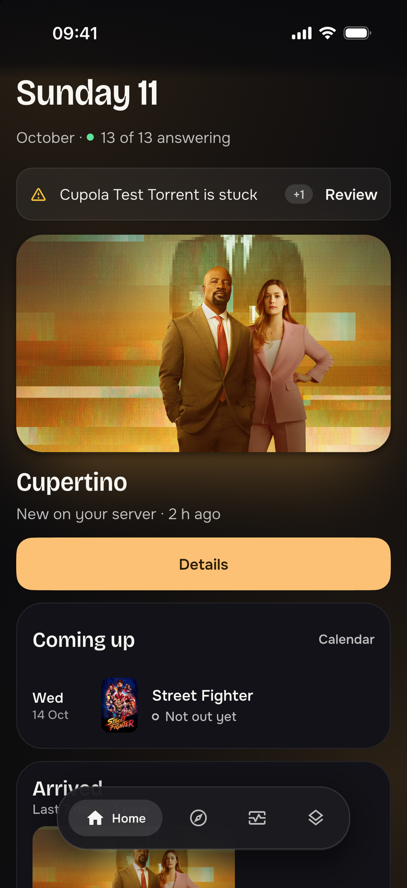
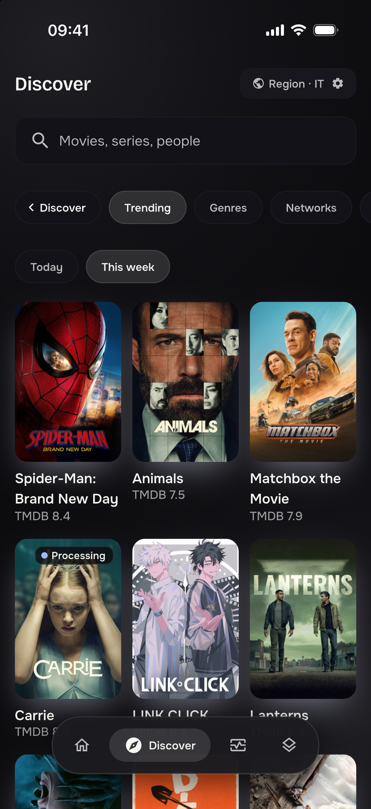
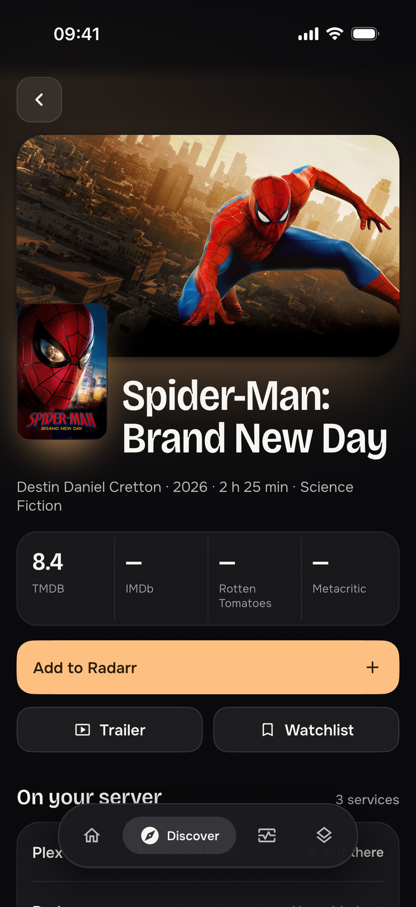
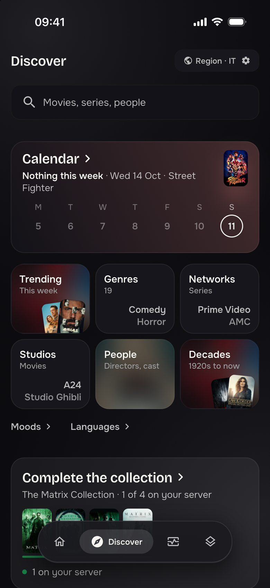
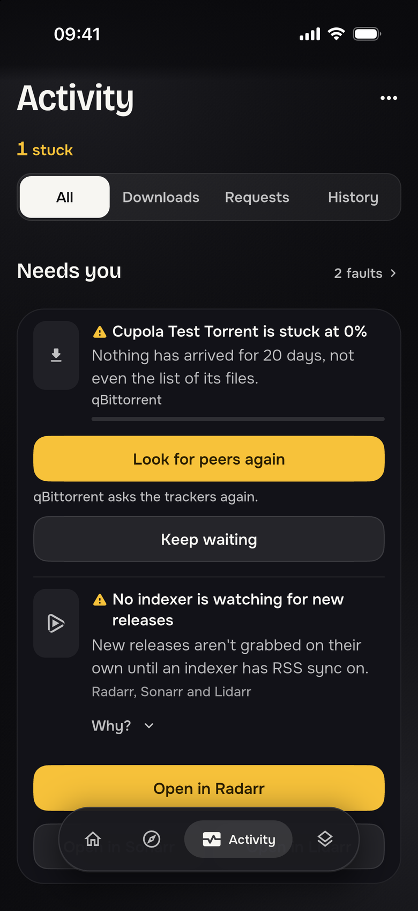
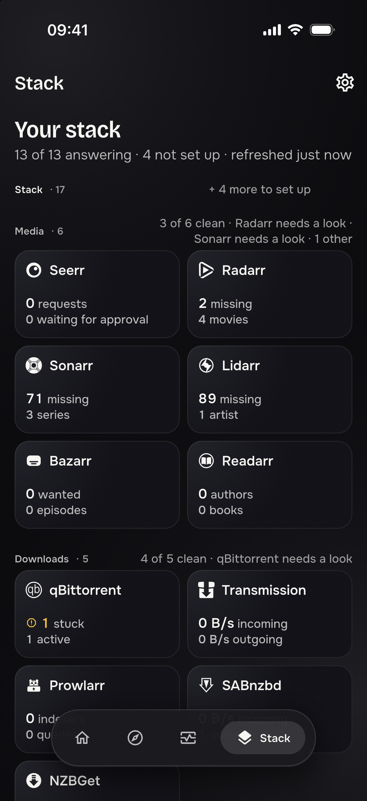
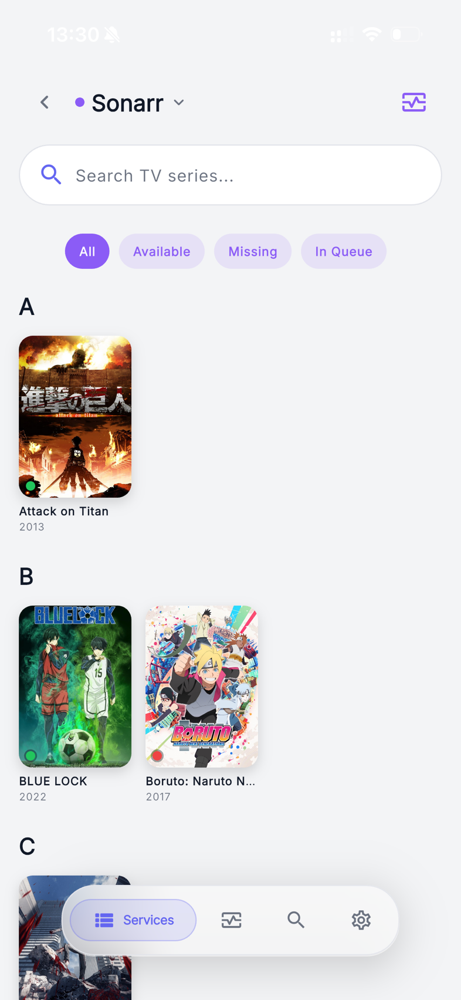
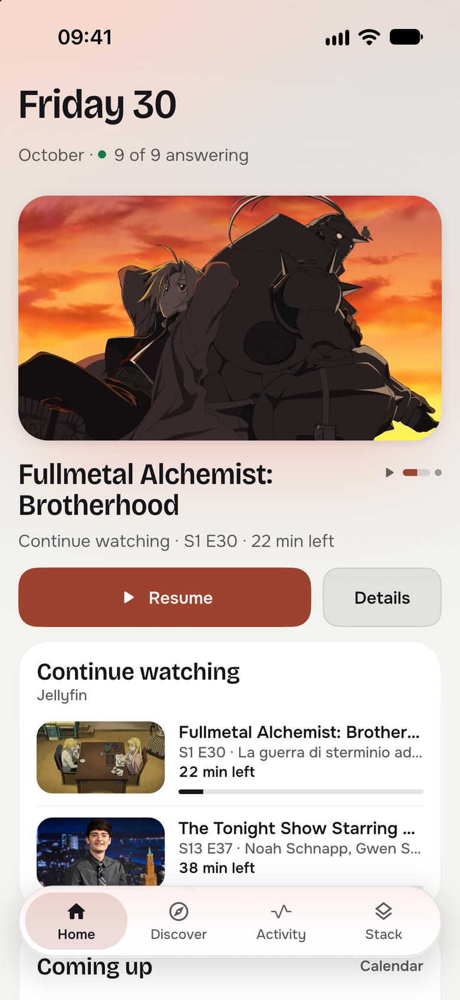
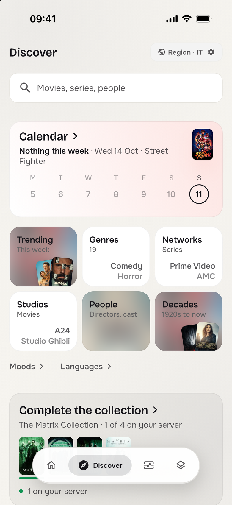
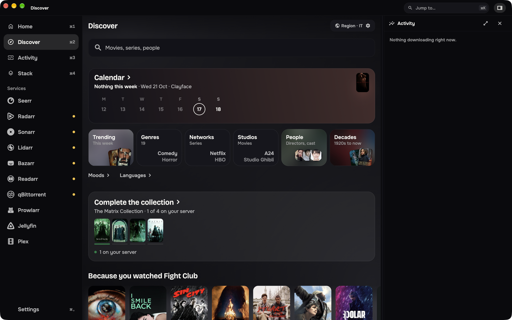

<div align="center">


# Cupola

**A Cupola over your server.**

One native app for your entire self-hosted media stack, and the box it runs on.<br/>
**17 services. iOS, Android, macOS. No cloud, no account, no middleman.**

[](https://github.com/matthw-labs/seekarr/actions/workflows/ci.yml)
[](https://github.com/matthw-labs/seekarr/releases)


[](LICENSE)
[](https://ko-fi.com/matthwlabs)

<br/>





</div>

---

## Why Cupola

Running a media stack means running a dozen web UIs. On a phone, most of them are
unusable, and none of them know about each other. Cupola is the single client that
does.

- **The whole stack, not a slice.** Seerr, the *arr family, four download clients,
  two media servers, and the infrastructure underneath: TrueNAS, Unraid, Dockge,
  Nginx Proxy Manager. Every one of them first-class, none of them a bolt-on.
- **Your instances are the backend.** There is no Cupola server, no relay, no
  telemetry, no sign-up. The app speaks directly to the hosts you own, and
  credentials live in the device keychain. The one exception is documented rather
  than hidden: [background search](#security--privacy) hands a request to the OS,
  API key included, which is why it ships off.
- **Built for home-lab reality.** Self-signed certificates, services behind a
  reverse proxy, boxes that are asleep or unreachable: all normal daily states,
  handled as such instead of as errors.
- **It tells you what needs you.** A stuck download, a disk with errors, an
  indexer that stopped watching for releases: Cupola says what happened in plain
  words, once, and puts the way out on the same card.
- **One experience everywhere.** Designed for the phone first, then the tablet and
  the desktop window. The same design language on every platform, adapted to each
  one's ergonomics rather than reskinned per OS.

## Contents

- [Screenshots](#screenshots)
- [Supported services](#supported-services)
- [Features](#features)
- [Install](#install)
- [Configuration](#configuration)
- [Security & privacy](#security--privacy)
- [Build from source](#build-from-source)
- [Architecture](#architecture)
- [Project status](#project-status)
- [Contributing](#contributing)
- [FAQ](#faq)
- [Support](#support)
- [License](#license)

---

## Screenshots

<table>
  <tr>
    <td align="center" width="33%"><br/><sub><b>Home</b> · what is new, what is next, what needs you</sub></td>
    <td align="center" width="33%"><br/><sub><b>Discover</b> · calendar, trending, every way in</sub></td>
    <td align="center" width="33%"><br/><sub><b>A title</b> · one page to decide and act</sub></td>
  </tr>
  <tr>
    <td align="center"><br/><sub><b>Activity</b> · what went wrong, and the way out</sub></td>
    <td align="center"><br/><sub><b>Stack</b> · every service at a glance</sub></td>
    <td align="center"><br/><sub><b>Sonarr</b> · each service's own room</sub></td>
  </tr>
</table>

<details>
<summary><b>More screenshots</b>: light theme, trending</summary>
<br/>
<table>
  <tr>
    <td align="center" width="33%"><br/><sub>Home · light</sub></td>
    <td align="center" width="33%"><br/><sub>Discover · light</sub></td>
    <td align="center" width="33%"><br/><sub>Discover · trending this week</sub></td>
  </tr>
</table>
</details>

<p align="center"><br/><sub><b>On the desktop</b> · the same app, with a navigation rail, a command palette and an inspector</sub></p>

Light and dark are both first-class themes. Neither is an inverted afterthought.
Every screenshot is the app running against real services, not a mock-up.

---

## Supported services

Configure only what you run: an unconfigured service simply stays out of the way.

Two columns are worth reading before you judge an integration:

- **Control.** How far Cupola goes today: full read *and* write, or mostly reading.
- **Tested.** Whether the integration has been exercised against a **real, running
  instance**, not just against fixtures. Every service has unit tests; that is a
  different claim. This column is deliberately conservative:
  **✅ verified** end to end · **◐ partial**, where the screens have read a real
  instance (or a faithful stand-in) but its actions have not been run against one ·
  **○ untested**, written to the official API but never run against a live
  instance. If you run one of the ones we could not test, a report either way is
  the single most useful thing you can send us.

### Media

| Service | What Cupola does | Auth | Control | Tested |
| --- | --- | --- | --- | :-: |
| **Seerr** (Overseerr / Jellyseerr) | Powers Discover: trending, calendar, genres, networks, studios, people, collections. Send, approve and decline requests, resolve issues, keep a watchlist. Household members sign in with their own account | API key, or a member's own sign-in (email, Jellyfin or Plex) | Read + write | ✅ |
| **Radarr** | Full movie library, calendar, queue, wanted and history; auto and interactive search, monitoring, quality profiles, manual import, delete | API key | Read + write | ✅ |
| **Sonarr** | Everything Radarr does, plus seasons and episodes with per-season / per-episode search | API key | Read + write | ✅ |
| **Lidarr** | Everything Radarr does, plus an artist's page with every album and where it stands | API key | Read + write | ✅ |
| **Bazarr** | Subtitle library, wanted episodes and movies, history, providers (and resetting their throttles) | API key | Mostly read | ◐ |
| **Readarr** | Author pages with every book and where it stands; search, monitor and delete. Adding authors is left out: Readarr is retired and its metadata service no longer answers | API key | Manage | ◐ |

### Downloads

| Service | What Cupola does | Auth | Control | Tested |
| --- | --- | --- | --- | :-: |
| **qBittorrent** | Live queue with filters, sorting and search; per-torrent Info / Files / Trackers / Actions; pause, resume, force-start, recheck, reannounce, speed limits, categories, tags, delete | User + password | Read + write | ✅ |
| **Transmission** | Live queue, labels and session settings; start, stop, verify, reannounce, reorder, add, delete, speed limits | User + password | Read + write | ✅ |
| **Prowlarr** | Indexer overview and usage stats; add, edit, test, delete and bulk-manage indexers; push to connected apps; tags and app profiles | API key | Read + write | ✅ |
| **SABnzbd** | Live queue, history and servers; pause and resume one job or everything, add by URL, delete | API key | Read + write | ✅ |
| **NZBGet** | Live queue, history, feeds and messages; pause and resume, add, delete | User + password | Read + write | ✅ |

### Stream

| Service | What Cupola does | Auth | Control | Tested |
| --- | --- | --- | --- | :-: |
| **Jellyfin** | Who is watching right now, transcode reasons, resume points, libraries, users, devices and tasks; pause, stop or message a session | API key + viewer, or a user's own sign-in | Read + sessions | ✅ |
| **Plex** | The same session-first board, driven by Plex's own semantics: libraries, on deck, devices, playlists; stop a session with a reason | Token | Read + stop | ◐ |

### Infrastructure

| Service | What Cupola does | Auth | Control | Tested |
| --- | --- | --- | --- | :-: |
| **TrueNAS** | Full console: dashboard, pools and disks, datasets and snapshots, SMB/NFS shares, apps, virtualization, replication and periodic tasks, reporting, users and groups; a disk with errors offers the scrub that repairs it | API key | Read + write | ◐ |
| **Dockge** | Compose stacks with live terminal output: start, stop, restart, update, down, and edit or deploy the compose file itself | User + password | Read + write | ✅ |
| **Unraid** | Array status, disks, shares, Docker containers, VMs and notifications; start and stop VMs, archive notifications | API key | Read + VMs | ○ ¹ |
| **Nginx Proxy Manager** | What the box is fronting, what is broken, which certificates are about to lapse; enable/disable hosts, retarget a forward, renew a certificate | Email + password | Read + write | ◐ |

¹ Unraid is an operating system rather than a container, and we do not run one, so its
integration is tested against recorded answers from its API, never against a server.

---

## Features

<details open>
<summary><b>Home: the evening at a glance</b></summary>
<br/>

What arrived on your server, what airs or comes out next, what you were halfway
through, and what needs you, on one page. Home is made of modules: keep the ones you
want, in the order you want, and leave the rest out.

</details>

<details>
<summary><b>Discover: find something to watch</b></summary>
<br/>

Trending this week, a calendar of what is coming, and every way in: genres, networks,
studios, people, decades, moods and languages, plus the collections you have only
part of. Type once and Seerr, Radarr, Sonarr, Jellyfin and Plex answer side by side,
so "do I already have this?" is one search instead of five browser tabs.

Tap a poster and one page tells you the ratings, who is in it, where it stands on
your server, and plays the trailer. Then act from that same page: add it to your
library, send a request, pick a specific release yourself, or clear out something you
no longer want.

</details>

<details>
<summary><b>Activity: what went wrong, and the way out</b></summary>
<br/>

*Needs you* gathers what the stack cannot fix by itself: a download stuck for days,
imports waiting for a decision, a container that stopped, a disk reporting errors, an
indexer that stopped watching for new releases. Each one says what happened in the
app's own words, once, with the service's raw message one tap away, and leads with
the remedy its cause names: try another download, look for peers again, review the
import, start the container, scrub the pool.

Downloads from all four clients sit in one list, moving first and stuck next, with
stop and resume on every row. Requests and history are a tab away.

</details>

<details>
<summary><b>Stack: every service in its own room</b></summary>
<br/>

The Stack shows the whole lab in bands (media, downloads, streaming, the box itself)
and says which services are clean and which need a look. Each service opens on its
own Overview, with its own tabs: Radarr's library, calendar, queue and wanted list;
qBittorrent's queue with filters, sorting, categories, tags and speed limits;
TrueNAS's full console.

- Grab something automatically, or open the release list and choose it yourself
- Flip monitoring, change quality profile, import files that landed in the wrong place
- Delete properly, with a clear say over the files and over whether it can come back

</details>

<details>
<summary><b>Outside the app: widgets and notifications</b></summary>
<br/>

Home-screen widgets on iOS and Android: *Coming up* and *Downloads* for whoever runs
the stack (Downloads also on the iPhone lock screen), *Requests* for a household
member. Two notifications, both off until you turn them on in **Settings →
Notifications**: *Needs you*, when something on the stack turns into a fault, and
*Ready to watch*, when something you asked for arrives. The phone works them out
itself, in the background, against your own services: there is no push server.
How often that background run happens is up to the operating system.

</details>

<details>
<summary><b>At home and away</b></summary>
<br/>

A connection can carry two addresses: the one it has at home and the one it has
away from it (a reverse proxy, a tunnel, a VPN name). Cupola knocks on both and uses
whichever answers, so the same app works on the sofa and on the train. A service that
only exists at home says so, with the last thing it knew, instead of failing.

Setting up a second phone takes one code: **Settings → Security → Set up another
device** copies every connection across, encrypted, over your own Wi-Fi. To bring in
someone from the household, **Invite someone** from Seerr gives them a link or a QR
code that carries the server's address, never its API key.

</details>

<details>
<summary><b>For the whole household</b></summary>
<br/>

Not everyone at home runs the stack. A household member signs in to Seerr with their
own account (email, Jellyfin or Plex) and gets a simpler Cupola: Home, Discover and
their requests, with no operator controls and none of the plumbing. Whatever the
server would refuse their account is never offered as a button.

</details>

<details>
<summary><b>Made to be looked at</b></summary>
<br/>

Cupola is a native app rather than a web UI in a shell, and it is meant to feel like one.

- An interface in ink and paper, where colour means something: green is done, amber is
  a fault, red is unreachable, blue is waiting. Colour that means nothing is left out
- Light and dark, both designed rather than inverted
- Empty, broken and not-yet-configured screens that say something useful, in one voice
- Reading at a large system font size? Everything grows with it. Nothing clips
- VoiceOver and TalkBack: each row speaks one sentence instead of a pile of fragments
- Buttons sized and spaced for thumbs, not for a mouse pointer
- Designed for the phone first. On a tablet a title opens beside the list it came
  from; on the desktop the window gets a navigation rail, a command palette and an
  inspector

</details>

<details>
<summary><b>Searches that outlive the screen</b></summary>
<br/>

Interactive search is slow because your indexers are slow. Tap *Keep searching*, put the
phone away, and the answer is waiting in Activity when you come back.

On a phone that means the operating system runs the request for you, and to do that it
writes the request down, API key included, until the search ends. Every app that works in
the background pays this; no clever coding avoids it. So it ships **off**, and turning it
on in **Settings → Background search** tells you the same thing in the same words. What
Cupola does is keep the window narrow: a task expires after 11 minutes, finished records
are cleared at every launch and the moment you switch the feature off, and on Android none
of it is in a backup. On iOS one copy can ride along in a device backup: encrypt the
backup, or use iCloud with Advanced Data Protection, and it is covered.

On desktop the question never arises. Nothing suspends the app, so a search just keeps
running while Cupola is open.

</details>

---

## Install

> **Just want to use it?** Grab the file for your platform from
> [**Releases**](https://github.com/matthw-labs/seekarr/releases). No toolchain
> needed. Releases before 1.0.0 were published under the project's former name,
> Seekarr, and cover fewer services than this page describes.

| Platform | Status | Download |
| --- | --- | --- |
| **Android** | Supported | `.apk` |
| **macOS** | Supported | `.dmg` |
| **iOS** | Supported (sideload) | unsigned `.ipa` |
| Windows / Linux | Built by CI, untested | `.zip` / `.tar.gz` |
| Web | Not a goal | none |

<details>
<summary><b>Android</b></summary>
<br/>

Download the `.apk` and install it. You may need to allow installs from unknown
sources for your browser or file manager.

</details>

<details>
<summary><b>macOS</b></summary>
<br/>

Download the `.dmg`, drag **Cupola** to `/Applications`, and launch it. On first run
right-click the app and choose **Open** to get past Gatekeeper.

</details>

<details>
<summary><b>iOS</b></summary>
<br/>

The `.ipa` is **not signed by Apple**, so it has to go through a sideloading tool
that applies an ad-hoc signature on install:

- [**AltStore**](https://altstore.io/): refreshes over Wi-Fi from the same machine
- [**Sideloadly**](https://sideloadly.io/): desktop tool, no account needed on macOS
- [**SideStore**](https://sidestore.io/): AltStore's sibling, refreshes on the phone itself

Ad-hoc signatures expire, so the app needs periodic re-installation: **7 days** with
a free Apple ID, **1 year** with a paid Apple Developer account.

</details>

<details>
<summary><b>Windows, Linux</b></summary>
<br/>

Both have a real runner with the desktop window. Each release carries a build made by
GitHub Actions: on Windows unzip it and run `cupola.exe` (the build is not signed, so
SmartScreen asks once); on Linux untar it and run `cupola` (it needs GTK 3 and
libsecret, present on most desktops). We have not run either ourselves, so a report
either way helps. There is no web client, by design.

</details>

---

## Configuration

Cupola ships with no default credentials and no bundled endpoints. Open
**Settings → Connections** and add the services you actually run. Each one needs a
base URL plus whatever it authenticates with (see the
[services tables](#supported-services)).

A few notes worth knowing up front:

- **A guided first run.** On first launch Cupola walks you through the services you
  run, one at a time, and skips the rest.
- **Everything is optional.** Configure one service or all seventeen. Unconfigured
  services render a clear placeholder instead of an error, and never block a screen.
- **More than one of each.** Two Radarrs (say, one for 4K) are two connections; the
  app shows them together and lets you look at one at a time.
- **Behind a gateway.** A connection can carry what a gateway in front of the service
  asks for: a Cloudflare Access service token, a proxy password, or custom headers.
  Cupola recognises a gateway's sign-in page instead of reading it as an empty answer.
- **Household members** sign in to Seerr with their own account instead of the API
  key, and get the household version of the app (see [Features](#features)).
- **Test before you save.** Each connection can be verified in place, with a
  specific reason when it fails (wrong key, wrong host, TLS refused) rather than a
  generic failure.
- **Jellyfin needs a viewer.** A Jellyfin API key authenticates as an administrator
  with no user attached, so the settings screen asks which user's perspective to
  use once the connection succeeds. Plex needs no equivalent: its token *is* its
  user.
- **Nginx Proxy Manager has no API key.** NPM only accepts the account email and
  password, which it exchanges for a short-lived token. That is a property of the
  server, not a shortcut here.
- **Region preference** shapes watch providers and content ratings where the
  upstream API is region-aware.

---

## Security & privacy

Cupola has no server-side component, so there is no Cupola-shaped place for your
data to go.

- **No account, no cloud, no telemetry.** Nothing is collected, and there is no
  backend to collect it.
- **Two third parties, each for one thing.** Poster, backdrop and cast artwork is
  fetched straight from TMDB's CDN (`image.tmdb.org`), because that is where your
  Seerr's metadata points. Those requests carry no credential and no identifier of
  yours, but they are requests to a host that is not yours, and TMDB sees the IP
  they come from. Signing in to Seerr with a Plex account goes through plex.tv's
  own sign-in, once, and Cupola keeps none of the token it gets. Everything else,
  metadata included, comes from your own instances.
- **Secrets stay on the device.** API keys, tokens and passwords go into
  `flutter_secure_storage`: Keychain on Apple platforms, Keystore-backed on
  Android. Plaintext settings from older versions are migrated on first launch.
- **Self-signed certificates, done properly.** Trust-on-first-use with SHA-256
  fingerprint pinning, scoped to the **TLS origin** rather than to the service,
  because a certificate belongs to a host and not to whichever service you reached
  through it. Two services behind the same reverse proxy are therefore trusted, and
  revoked, together. Review or forget any of them under
  **Settings → Security → Trusted certificates**.
- **Pinning covers images too.** Posters and artwork use a separate HTTP stack, so
  they go through a dedicated pinned image cache rather than silently bypassing the
  pin.
- **Background search is opt-in.** Letting a search survive leaving the app means
  handing the request, API key and all, to the operating system for the length of the
  task, so it is off until you turn it on, and the trade-off is written next to the
  switch.

The whole trust layer is one reviewable file: [`lib/core/network/cert_trust.dart`](lib/core/network/cert_trust.dart).

---

## Build from source

**Prerequisites**

- Flutter SDK compatible with Dart `^3.10.0` (CI pins stable **3.38.7**)
- **iOS / macOS**: current stable Xcode · **Android**: Android Studio, compileSdk 36
- At least one reachable service from the [tables above](#supported-services)

```bash
git clone https://github.com/matthw-labs/seekarr.git
cd seekarr
flutter pub get
flutter run
```

**Checks and packaging**

```bash
flutter analyze --fatal-infos
dart format --output=none --set-exit-if-changed .
flutter test
scripts/release.sh all
```

CI runs the first three on every push; infos are fatal. The test suite is offline
and deterministic by design: no network, no live instance. An opt-in end-to-end tier
runs against real services in Docker:

```bash
docker compose -f docker-compose.e2e.yml up -d --wait
flutter test --tags e2e --run-skipped
```

---

## Architecture

Feature-first layers over a shared core. Adding a service starts in one file,
`ServiceKey`, the registry every other layer reads from.

```
lib/
├── core/                    # theme + tokens, router, API client, network trust,
│   │                        # reusable widgets, text-scale metrics
│   └── ...
└── features/
    └── <feature>/
        ├── data/            # clients and API calls
        ├── domain/          # models, semantics, capabilities
        └── presentation/    # screens, providers, widgets
```

| Concern | Choice |
| --- | --- |
| UI | Flutter + Material 3, a fixed palette and design tokens, bundled Bricolage Grotesque, Onest and Geist Mono |
| State | Riverpod 3: `FutureProvider` for loads, `NotifierProvider` for persisted state |
| Navigation | go_router; every detail route resolves from path params alone, so any screen is addressable by path, and the `cupola://` scheme lets a widget, a notification or an invite open one |
| HTTP | Dio, shared `ApiClient` with `X-Api-Key` for the *arr family |
| Other transports | qBittorrent WebUI v2 form login, Socket.IO for Dockge, WebSocket JSON-RPC for TrueNAS |
| Storage | `flutter_secure_storage` for secrets, `shared_preferences` for settings |
| Lists | `infinite_scroll_pagination`, `cached_network_image` behind a pinned cache |

Two conventions worth calling out, because they shape most of the code:

- **Unreachable is normal.** Missing config throws a recognizable exception that the
  shared `AsyncValueWidget` turns into a not-configured placeholder. Browse and load
  methods degrade to empty rather than exploding; only user-initiated mutations
  surface errors.
- **Nothing blocks the UI thread.** Search and release fetches carry `CancelToken`s,
  and large JSON list mapping runs in an isolate, so mapping functions stay pure.

The service registry every layer reads from is
[`lib/features/settings/domain/service_key.dart`](lib/features/settings/domain/service_key.dart);
the theme in [`lib/core/theme.dart`](lib/core/theme.dart) and routing in
[`lib/core/router.dart`](lib/core/router.dart). The design system (tokens, the brand
book and a rendered card for every widget) starts at [`design/README.md`](design/README.md).
Conventions and PR expectations are written up in [CONTRIBUTING.md](CONTRIBUTING.md).

---

## Project status

We develop Cupola actively and run it on our own stacks every day. Everything on this
page is implemented and running rather than planned. The badge at the top points at the
latest published release, which trails `main` between tags. 1.0.0 is the first release
of the Cupola line, and everything before it was published as Seekarr.

- **17 services integrated.** **11 we have verified against real instances**, 5
  partially, and Unraid against recorded answers only. The
  [tables above](#supported-services) say which is which, per service.
- **About 750 test files** covering models, services, providers and widgets, offline
  by default, with an opt-in Docker-backed end-to-end tier against real services
- **Accessibility is part of the definition of done.** Dynamic Type, contrast, touch
  targets and screen-reader labels are held by tests. If something reads badly with
  VoiceOver or TalkBack, that is a bug: please report it.
- **Explicit non-goals**, so nobody files them as bugs: no server or cloud component,
  no web client, no account layer, and no localization. English-only is a decision we
  made, not a gap. CI does build for web, but only as a compile check: the result is
  not a product and is not published.

---

## Contributing

We welcome contributions: bug reports, integrations, polish, and especially help
closing the accessibility gap.

Please **open an issue first** so we can agree on scope and direction before you write
code. We review issues and PRs in our spare time, so expect a human pace rather than a
CI-fast one.

Setup notes, conventions and PR expectations: [**CONTRIBUTING.md**](CONTRIBUTING.md).

---

## FAQ

<details>
<summary><b>Does Cupola need a server, or an account?</b></summary>
<br/>
No. It talks straight to your instances over LAN, VPN or a reverse proxy. There is
no Cupola backend, so there is nothing to sign up for and nothing reporting back to
us. What leaves your network is artwork from TMDB's image CDN, and plex.tv when you
sign in to Seerr with Plex: see [Security & privacy](#security--privacy).
</details>

<details>
<summary><b>Will it work with Overseerr and Jellyseerr?</b></summary>
<br/>
Yes. Both are supported through the same Seerr integration.
</details>

<details>
<summary><b>My services are behind a reverse proxy with a self-signed certificate.</b></summary>
<br/>
That is the expected setup. Cupola offers to trust the certificate the first time it
sees it and pins its fingerprint, scoped to the host. See
<a href="#security--privacy">Security &amp; privacy</a>.
</details>

<details>
<summary><b>Why is service X read-only?</b></summary>
<br/>
Because we have not mapped and tested its write layer yet. Each integration ships
read-first and gains actions once we understand how its API really behaves. Open an
issue if you want us to prioritize a particular one.
</details>

<details>
<summary><b>What does "not tested" mean for a service?</b></summary>
<br/>
That we wrote the integration against the service's official API and covered it with
unit tests, but never pointed it at a live instance, because we do not run that service
ourselves. It may well work perfectly. We list it honestly rather than optimistically,
and a report from anyone who does run it turns a <b>○</b> into a <b>✅</b> (or into a
bug worth fixing).
</details>

<details>
<summary><b>Can I run it on Linux or Windows?</b></summary>
<br/>
Yes: each release carries a Windows and a Linux build made by GitHub Actions, with the
same desktop window as macOS. We have not run either ourselves, so a report is welcome.
</details>

<details>
<summary><b>Why not localized?</b></summary>
<br/>
A deliberate decision, not missing work: user-facing strings are English by design
and there is no localization scaffolding.
</details>

---

## About this project

We started Cupola for ourselves: managing a self-hosted *arr stack from a phone, from
anywhere, without friction. It grew into a homelab hub because our stacks never really
stopped at the *arrs.

We build it for getting the details right (polished interactions, honest error and
empty states, and a test suite that keeps them honest) rather than for shipping fast.

---

## Support

If Cupola is useful to you, a donation helps us keep it moving.

<a href="https://ko-fi.com/matthwlabs"></a>

---

## License

Licensed under the **[Apache License 2.0](LICENSE)**.

Cupola was previously distributed under the MIT License. That license still covers
copies obtained before the change, and its original notice is preserved in
[LICENSE-MIT](LICENSE-MIT); see [NOTICE](NOTICE) for details.

The bundled typefaces, [Bricolage Grotesque](https://github.com/ateliertriay/bricolage),
[Onest](https://github.com/googlefonts/onest) and
[Geist Mono](https://github.com/vercel/geist-font), are licensed separately
under the SIL Open Font License 1.1; each license text ships alongside its font
in [assets/fonts/](assets/fonts/).

### Trademarks

Cupola is an independent project. It is not affiliated with, endorsed or sponsored by
the makers of the services it connects to, whose names are used only to identify them.

- Plex and Plex Media Server are trademarks of Plex and used under a license.
- TrueNAS® is a registered trademark of iXsystems, dba TrueNAS.
- Unraid® is a registered trademark of Lime Technology, Inc. This application is not
  affiliated with, endorsed, or sponsored by Lime Technology, Inc.

All other product names are trademarks of their respective owners. The same notice
ships in the app, under Settings → About → Licenses & trademarks.
