<div align="center">


# Cupola

**A cupola over your lab.**

One native app for your entire self-hosted media stack, and the box it runs on.<br/>
**17 services. iOS, Android, macOS. No cloud, no account, no middleman.**

[](https://github.com/matthw-labs/seekarr/actions/workflows/ci.yml)
[](https://github.com/matthw-labs/seekarr/releases)


[](LICENSE)
[](https://ko-fi.com/matthwlabs)

<br/>

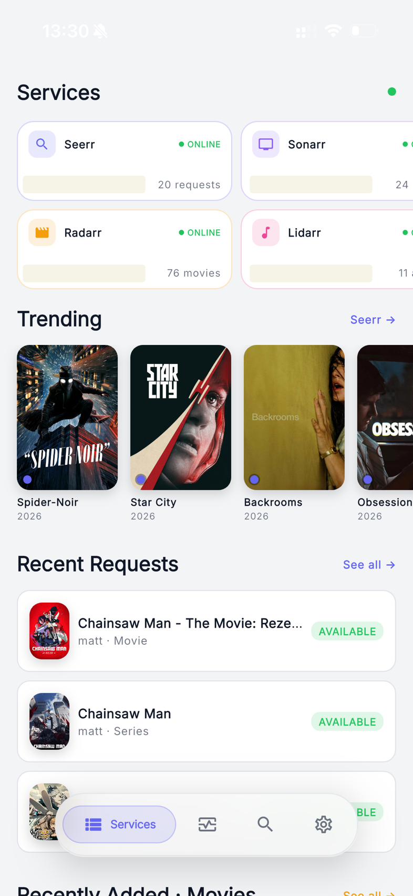
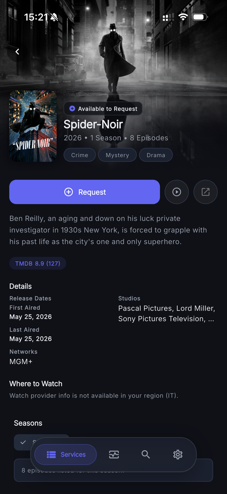
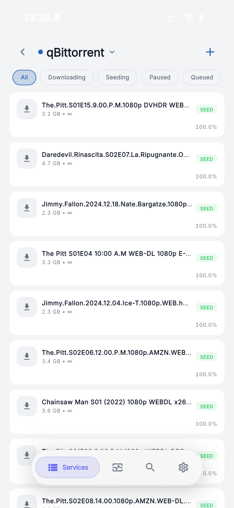

</div>

---

## Why Cupola

Running a media stack means running a dozen web UIs. On a phone, most of them are
unusable, and none of them know about each other. Cupola is the single client that
does.

- **The whole stack, not a slice.** Seerr, the *arr family, four download clients,
  two media servers, and the infrastructure underneath: TrueNAS, Unraid, Dockge,
  Nginx Proxy Manager. Every one of them first-class, none of them a bolt-on.
- **Your instances are the backend.** There is no Cupola server, no relay, no
  telemetry, no sign-up. The app speaks directly to the hosts you own; credentials
  live in the device keychain and never leave it.
- **Built for home-lab reality.** Self-signed certificates, services behind a
  reverse proxy, boxes that are asleep or unreachable: all normal daily states,
  handled as such instead of as errors.
- **One experience everywhere.** The same design language on iOS, Android and
  macOS, adapted to each platform's ergonomics rather than reskinned per OS.

## Contents

- [Screenshots](#screenshots)
- [Supported services](#supported-services)
- [Features](#features)
- [Install](#install)
- [Configuration](#configuration)
- [Security & privacy](#security--privacy)
- [Build from source](#build-from-source)
- [Architecture](#architecture)
- [Project status](#project-status)
- [Contributing](#contributing)
- [FAQ](#faq)
- [Support](#support)
- [License](#license)

---

## Screenshots

<table>
  <tr>
    <td align="center" width="33%"><br/><sub><b>Services</b> · the whole stack at a glance</sub></td>
    <td align="center" width="33%"><br/><sub><b>Sonarr</b> · per-service dashboard</sub></td>
    <td align="center" width="33%"><br/><sub><b>Activity</b> · queue, history, blocklist</sub></td>
  </tr>
  <tr>
    <td align="center">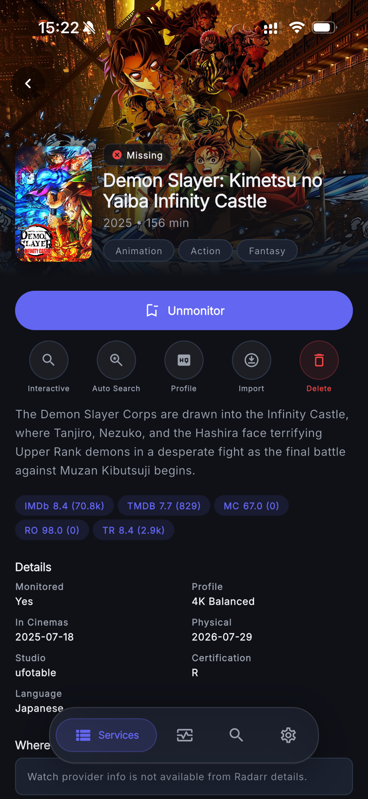<br/><sub><b>Detail</b> · cinematic collapsing hero</sub></td>
    <td align="center">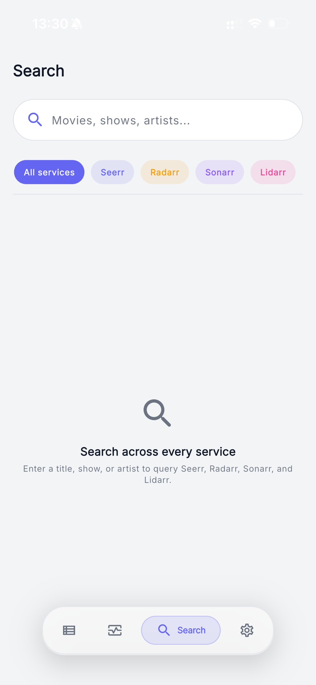<br/><sub><b>Search</b> · one query, every library</sub></td>
    <td align="center">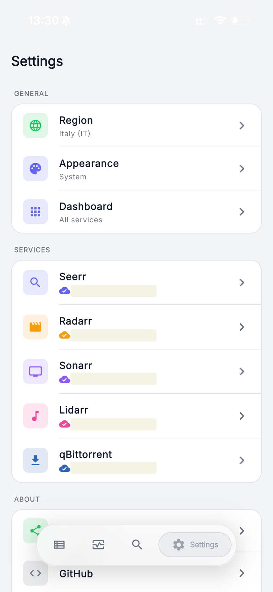<br/><sub><b>Settings</b> · connections and theme</sub></td>
  </tr>
</table>

<details>
<summary><b>More screenshots</b>: dark theme, Seerr, manual import, history</summary>
<br/>
<table>
  <tr>
    <td align="center" width="33%">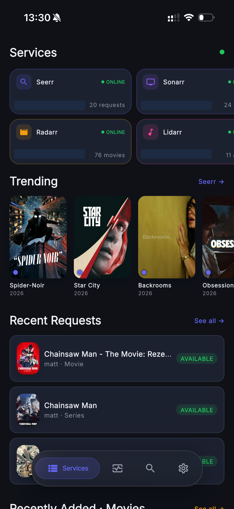<br/><sub>Services · dark</sub></td>
    <td align="center" width="33%">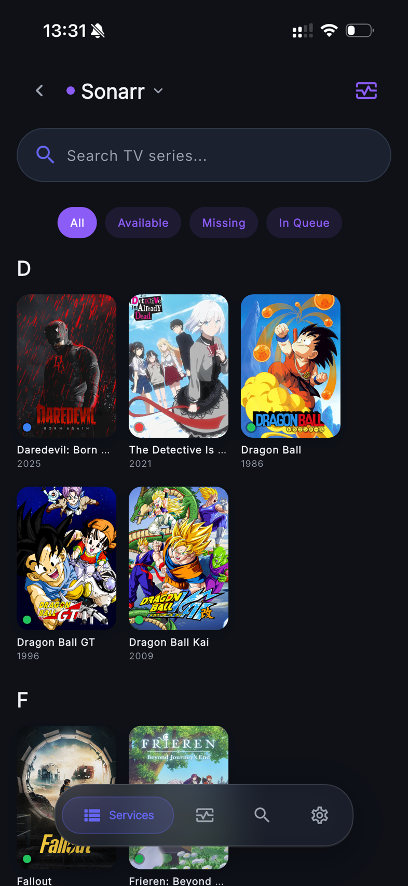<br/><sub>Sonarr · dark</sub></td>
    <td align="center" width="33%">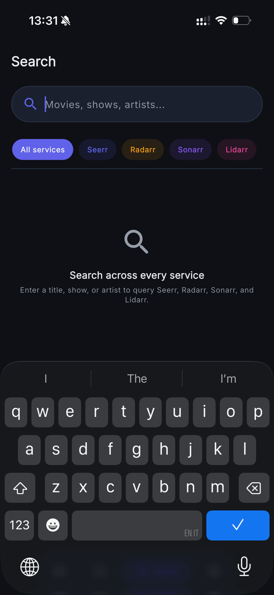<br/><sub>Search · dark</sub></td>
  </tr>
  <tr>
    <td align="center">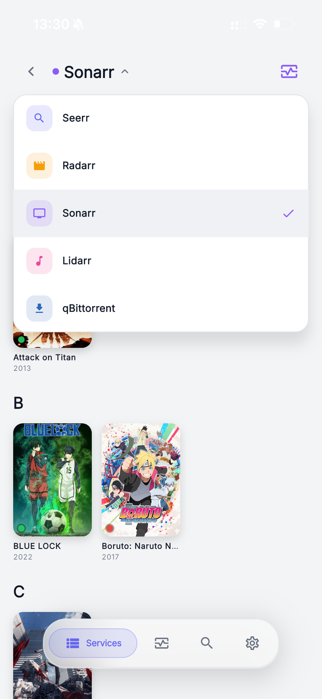<br/><sub>Services · list layout</sub></td>
    <td align="center">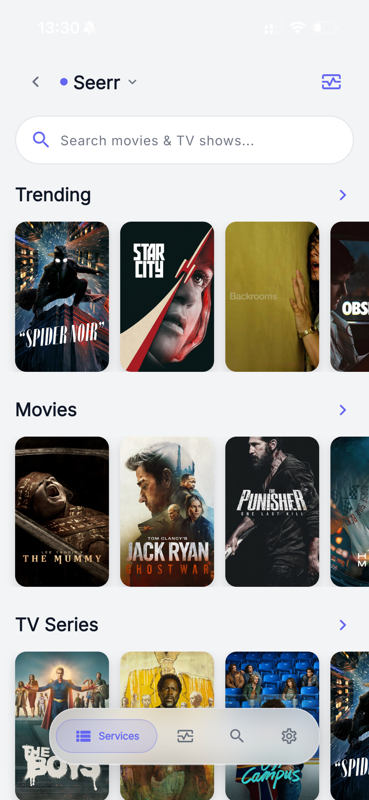<br/><sub>Seerr · discover</sub></td>
    <td align="center"><br/><sub>Seerr · media detail</sub></td>
  </tr>
  <tr>
    <td align="center">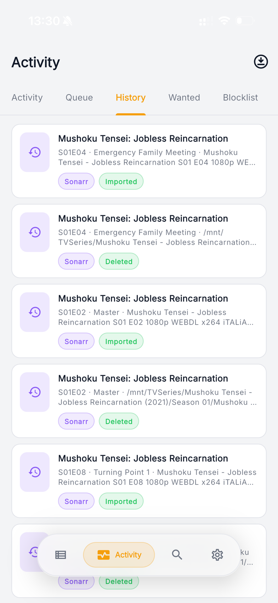<br/><sub>Activity · history</sub></td>
    <td align="center">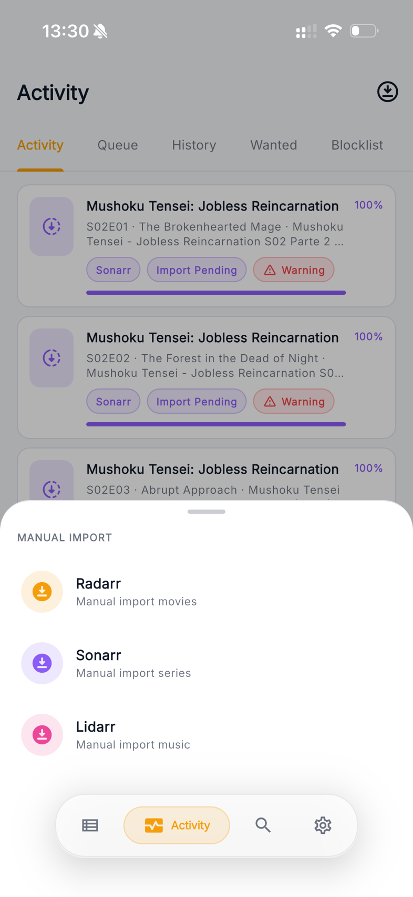<br/><sub>Manual import</sub></td>
    <td align="center">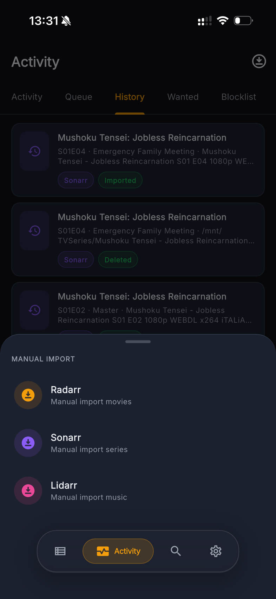<br/><sub>Manual import · dark</sub></td>
  </tr>
</table>
</details>

Light and dark are both first-class themes. Neither is an inverted afterthought.

---

## Supported services

Configure only what you run: an unconfigured service simply stays out of the way.

Two columns are worth reading before you judge an integration:

- **Control.** How far Cupola goes today: full read *and* write, or read-only for now.
- **Tested.** Whether the integration has been exercised against a **real, running
  instance**, not just against fixtures. Every service has unit tests; that is a
  different claim. This column is deliberately conservative:
  **✅ verified** end to end · **◐ partial**, where the main screens work but some
  areas are unexercised · **○ untested**, written to the official API but never run
  against a live instance. If you run one of the ones we could not test, a report
  either way is the single most useful thing you can send us.

### Media

| Service | What Cupola does | Auth | Control | Tested |
| --- | --- | --- | --- | :-: |
| **Seerr** (Overseerr / Jellyseerr) | Discover trending movies and TV, unified search, rich detail pages, send requests, manage existing media | API key | Read + write | ✅ |
| **Radarr** | Full movie library, status badges, auto and interactive search, monitoring, quality profiles, manual import, delete | API key | Read + write | ✅ |
| **Sonarr** | Everything Radarr does, plus seasons and episodes with per-season / per-episode search | API key | Read + write | ✅ |
| **Lidarr** | Everything Radarr does, plus per-artist album lists | API key | Read + write | ✅ |
| **Bazarr** | Subtitle library, wanted episodes and movies, history, badge counters | API key | Read-only | ○ |
| **Readarr** | Author overview, library KPIs, recent activity | API key | Read-only | ○ |

### Downloads

| Service | What Cupola does | Auth | Control | Tested |
| --- | --- | --- | --- | :-: |
| **qBittorrent** | Live queue with filters, sorting and search; per-torrent Info / Files / Trackers / Actions; pause, resume, force-start, recheck, reannounce, speed limits, categories, tags, delete | User + password | Read + write | ✅ |
| **Transmission** | Live queue and seeding view with the controls that act on both | User + password | Read + write | ○ |
| **Prowlarr** | Indexer overview and usage stats; add, edit, test, delete and bulk-manage indexers; push to connected apps; tags and app profiles | API key | Read + write | ✅ |
| **SABnzbd** | Live queue and recent history | API key | Read-only | ◐ |
| **NZBGet** | Live queue and recent history | User + password | Read-only | ○ |

### Stream

| Service | What Cupola does | Auth | Control | Tested |
| --- | --- | --- | --- | :-: |
| **Jellyfin** | Who is watching right now, transcode reasons, resume points, library browsing and item detail | API key + user | Read-only | ✅ |
| **Plex** | The same session-first board, driven by Plex's own semantics | Token | Read-only | ○ |

### Infrastructure

| Service | What Cupola does | Auth | Control | Tested |
| --- | --- | --- | --- | :-: |
| **TrueNAS** | Full console: dashboard, pools and disks, datasets and snapshots, SMB/NFS shares, apps, virtualisation, replication and periodic tasks, reporting, users and groups | API key | Read + write | ◐ |
| **Dockge** | Compose stacks with live terminal output: start, stop, restart, update, down, and edit or deploy the compose file itself | User + password | Read + write | ✅ |
| **Unraid** | Array status, disks, Docker containers | API key | Read-only | ○ |
| **Nginx Proxy Manager** | What the box is fronting, what is broken, which certificates are about to lapse; enable/disable hosts, retarget a forward, renew a certificate | Email + password | Read + write | ◐ |

---

## Features

<details open>
<summary><b>Find something to watch</b></summary>
<br/>

Open the app, scroll the carousels, tap a poster. One page tells you the ratings, where
it streams in your country, who is in it, what else belongs to the collection, and
plays the trailer.

Then act from that same page: add it to your library, send a request, pick a specific
release yourself, or clear out something you no longer want. No hop to a second app.

</details>

<details>
<summary><b>Your library in your pocket</b></summary>
<br/>

Every film, series and album you own, each with a glance-and-know badge: on disk,
monitored, still downloading. Pull to refresh, type to filter.

- Grab something new automatically, or open the release list and choose it yourself
- Flip monitoring, change quality profile, import files that landed in the wrong place
- Delete properly, with a clear say over the files and over whether it can come back

</details>

<details>
<summary><b>Downloads you can steer</b></summary>
<br/>

The queue as it happens: speeds, ETAs and progress bars that move while you watch them.

- One filter row for state, category, tag, tracker and free text
- Sort by whatever matters right now: size, progress, ETA, speed, how long it has sat there
- Pause, resume, force, recheck, cap the speed, retag, delete. Real actions, not links
  back out to a web UI

</details>

<details>
<summary><b>Activity: the control room</b></summary>
<br/>

What the stack has been up to, and what it has quietly failed to do. Queue, history and
blocklist in one place, next to everything still missing or waiting for a better copy.
Sonarr's wanted list is grouped the way you actually think about it, series then season
then episode, with a search button on every row.

</details>

<details>
<summary><b>One search for everything</b></summary>
<br/>

Type once, and Seerr, Radarr, Sonarr, Lidarr and Bazarr all answer side by side.
"Do I already have this?" becomes one action instead of five browser tabs.

</details>

<details>
<summary><b>Made to be looked at</b></summary>
<br/>

Cupola is a native app rather than a web UI in a shell, and it is meant to feel like one.

- Posters that expand into a cinematic header and carry across screens as you navigate
- Light and dark, both designed rather than inverted, each service keeping its own
  accent colour, with your system accent picked up where the platform offers one
- A navigation bar you choose: the services you actually use get the tabs
- Empty, broken and not-yet-configured screens that say something useful, in one voice
- Reading at a large system font size? Everything grows with it. Nothing clips
- Buttons sized and spaced for thumbs, not for a mouse pointer

</details>

---

## Install

> **Just want to use it?** Grab the file for your platform from
> [**Releases**](https://github.com/matthw-labs/seekarr/releases). No toolchain
> needed.

| Platform | Status | Download |
| --- | --- | --- |
| **Android** | Supported | `.apk` |
| **macOS** | Supported | `.dmg` |
| **iOS** | Supported (sideload) | unsigned `.ipa` |
| Linux / Windows / Web | Scaffolding only | build from source |

<details>
<summary><b>Android</b></summary>
<br/>

Download the `.apk` and install it. You may need to allow installs from unknown
sources for your browser or file manager.

</details>

<details>
<summary><b>macOS</b></summary>
<br/>

Download the `.dmg`, drag **Cupola** to `/Applications`, and launch it. On first run
right-click the app and choose **Open** to get past Gatekeeper.

</details>

<details>
<summary><b>iOS</b></summary>
<br/>

The `.ipa` is **not signed by Apple**, so it has to go through a sideloading tool
that applies an ad-hoc signature on install:

- [**AltStore**](https://altstore.io/): refreshes over Wi-Fi from the same machine
- [**Sideloadly**](https://sideloadly.io/): desktop tool, no account needed on macOS
- [**Sideload**](https://sideload.app/): web-based, runs in the browser

Ad-hoc signatures expire, so the app needs periodic re-installation: **7 days** with
a free Apple ID, **1 year** with a paid Apple Developer account.

</details>

<details>
<summary><b>Linux, Windows, Web</b></summary>
<br/>

The project scaffolding exists and the app builds, but we do not test or support these
targets. Contributions that harden them are welcome.

</details>

---

## Configuration

Cupola ships with no default credentials and no bundled endpoints. Open
**Settings → Connections** and add the services you actually run. Each one needs a
base URL plus whatever it authenticates with (see the
[services tables](#supported-services)).

A few notes worth knowing up front:

- **Everything is optional.** Configure one service or all seventeen. Unconfigured
  services render a clear placeholder instead of an error, and never block a screen.
- **Test before you save.** Each connection can be verified in place, with a
  specific reason when it fails (wrong key, wrong host, TLS refused) rather than a
  generic failure.
- **Jellyfin needs a viewer.** A Jellyfin API key authenticates as an administrator
  with no user attached, so the settings screen asks which user's perspective to
  use once the connection succeeds. Plex needs no equivalent: its token *is* its
  user.
- **Nginx Proxy Manager has no API key.** NPM only accepts the account email and
  password, which it exchanges for a short-lived token. That is a property of the
  server, not a shortcut here.
- **Region preference** shapes watch providers and content ratings where the
  upstream API is region-aware.

---

## Security & privacy

Cupola has no server-side component, so there is nowhere for your data to go but
your own machines.

- **No account, no cloud, no telemetry.** Nothing is collected, and there is no
  backend to collect it.
- **Secrets stay on the device.** API keys, tokens and passwords go into
  `flutter_secure_storage`: Keychain on Apple platforms, Keystore-backed on
  Android. Plaintext settings from older versions are migrated on first launch.
- **Self-signed certificates, done properly.** Trust-on-first-use with SHA-256
  fingerprint pinning, scoped to the **TLS origin** rather than to the service,
  because a certificate belongs to a host and not to whichever service you reached
  through it. Two services behind the same reverse proxy are therefore trusted, and
  revoked, together. Review or forget any of them under
  **Settings → Connections → Trusted certificates**.
- **Pinning covers images too.** Posters and artwork use a separate HTTP stack, so
  they go through a dedicated pinned image cache rather than silently bypassing the
  pin.

The whole trust layer is one reviewable file: [`lib/core/network/cert_trust.dart`](lib/core/network/cert_trust.dart).

---

## Build from source

**Prerequisites**

- Flutter SDK compatible with Dart `^3.10.0` (CI pins stable **3.38.7**)
- **iOS / macOS**: current stable Xcode · **Android**: Android Studio, compileSdk 36
- At least one reachable service from the [tables above](#supported-services)

```bash
git clone https://github.com/matthw-labs/seekarr.git
cd seekarr
flutter pub get
flutter run
```

**Checks and packaging**

```bash
flutter analyze --fatal-infos
dart format --output=none --set-exit-if-changed .
flutter test
scripts/release.sh all
```

CI runs the first three on every push; infos are fatal. The test suite is offline
and deterministic by design: no network, no live instance. An opt-in end-to-end tier
runs against real services in Docker:

```bash
docker compose -f docker-compose.e2e.yml up -d && flutter test --tags e2e
```

---

## Architecture

Feature-first layers over a shared core. Adding a service starts in one file,
`ServiceKey`, the registry every other layer reads from.

```
lib/
├── core/                    # theme + tokens, router, API client, network trust,
│   │                        # reusable widgets, text-scale metrics
│   └── ...
└── features/
    └── <feature>/
        ├── data/            # clients and API calls
        ├── domain/          # models, semantics, capabilities
        └── presentation/    # screens, providers, widgets
```

| Concern | Choice |
| --- | --- |
| UI | Flutter + Material 3, bundled Inter, `DynamicColorBuilder` |
| State | Riverpod 3: `FutureProvider` for loads, `NotifierProvider` for persisted state |
| Navigation | go_router; every detail route resolves from path params alone, so deep links work |
| HTTP | Dio, shared `ApiClient` with `X-Api-Key` for the *arr family |
| Other transports | qBittorrent WebUI v2 form login, Socket.IO for Dockge, WebSocket JSON-RPC for TrueNAS |
| Storage | `flutter_secure_storage` for secrets, `shared_preferences` for settings |
| Lists | `infinite_scroll_pagination`, `cached_network_image` behind a pinned cache |

Two conventions worth calling out, because they shape most of the code:

- **Unreachable is normal.** Missing config throws a recognisable exception that the
  shared `AsyncValueWidget` turns into a not-configured placeholder. Browse and load
  methods degrade to empty rather than exploding; only user-initiated mutations
  surface errors.
- **Nothing blocks the UI thread.** Search and release fetches carry `CancelToken`s,
  and large JSON list mapping runs in an isolate, so mapping functions stay pure.

The service registry every layer reads from is
[`lib/features/settings/domain/service_key.dart`](lib/features/settings/domain/service_key.dart);
design tokens live in [`lib/core/theme.dart`](lib/core/theme.dart) and routing in
[`lib/core/router.dart`](lib/core/router.dart). Conventions and PR expectations are
written up in [CONTRIBUTING.md](CONTRIBUTING.md).

---

## Project status

We develop Cupola actively and run it on our own stacks every day. Everything on this
page is shipped on `main` and in the latest release rather than planned, and the badge
at the top of this file always points at the current version.

- **17 services integrated.** **8 we have verified against real instances**, 3
  partially, 6 written to the official API but not yet exercised live; 7 are read-only
  for now. The [tables above](#supported-services) say which is which, per service.
- **~200 test files** covering models, services, providers and widgets, offline by
  default, with an opt-in Docker-backed end-to-end tier
- **Known gap: screen readers.** Dynamic Type and contrast are handled; VoiceOver and
  TalkBack coverage is real work in progress and we are closing it screen by screen.
  New UI ships labelled.
- **Explicit non-goals**, so nobody files them as bugs: no server or cloud component,
  no web client, no account layer, and no localisation. English-only is a decision we
  made, not a gap. Tablets keep working but are not a design target.

---

## Contributing

We welcome contributions: bug reports, integrations, polish, and especially help
closing the accessibility gap.

Please **open an issue first** so we can agree on scope and direction before you write
code. We review issues and PRs in our spare time, so expect a human pace rather than a
CI-fast one.

Setup notes, conventions and PR expectations: [**CONTRIBUTING.md**](CONTRIBUTING.md).

---

## FAQ

<details>
<summary><b>Does Cupola need a server, or an account?</b></summary>
<br/>
No. It talks straight to your instances over LAN, VPN or a reverse proxy. There is
no Cupola backend, so there is nothing to sign up for and nothing that phones home.
</details>

<details>
<summary><b>Will it work with Overseerr and Jellyseerr?</b></summary>
<br/>
Yes. Both are supported through the same Seerr integration.
</details>

<details>
<summary><b>My services are behind a reverse proxy with a self-signed certificate.</b></summary>
<br/>
That is the expected setup. Cupola offers to trust the certificate the first time it
sees it and pins its fingerprint, scoped to the host. See
<a href="#security--privacy">Security &amp; privacy</a>.
</details>

<details>
<summary><b>Why is service X read-only?</b></summary>
<br/>
Because we have not mapped and tested its write layer yet. Each integration ships
read-first and gains actions once we understand how its API really behaves. Open an
issue if you want us to prioritise a particular one.
</details>

<details>
<summary><b>What does "not tested" mean for a service?</b></summary>
<br/>
That we wrote the integration against the service's official API and covered it with
unit tests, but never pointed it at a live instance, because we do not run that service
ourselves. It may well work perfectly. We list it honestly rather than optimistically,
and a report from anyone who does run it turns a <b>○</b> into a <b>✅</b> (or into a
bug worth fixing).
</details>

<details>
<summary><b>Can I run it on Linux or Windows?</b></summary>
<br/>
You can build it, and it may well work, but we do not test or support either target.
</details>

<details>
<summary><b>Why not localised?</b></summary>
<br/>
A deliberate decision, not missing work: user-facing strings are English by design
and there is no localisation scaffolding.
</details>

---

## About this project

We started Cupola for ourselves: managing a self-hosted *arr stack from a phone, from
anywhere, without friction. It grew into a homelab hub because our stacks never really
stopped at the *arrs.

We build it for getting the details right (polished interactions, honest error and
empty states, and a test suite that keeps them honest) rather than for shipping fast.

---

## Support

If Cupola is useful to you, a donation helps us keep it moving.

<a href="https://ko-fi.com/matthwlabs"></a>

---

## License

Licensed under the **[Apache License 2.0](LICENSE)**.

Cupola was previously distributed under the MIT License. That licence still covers
copies obtained before the change, and its original notice is preserved in
[LICENSE-MIT](LICENSE-MIT); see [NOTICE](NOTICE) for details.
